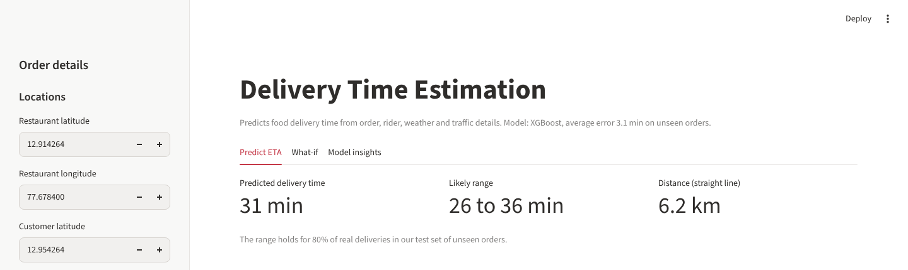
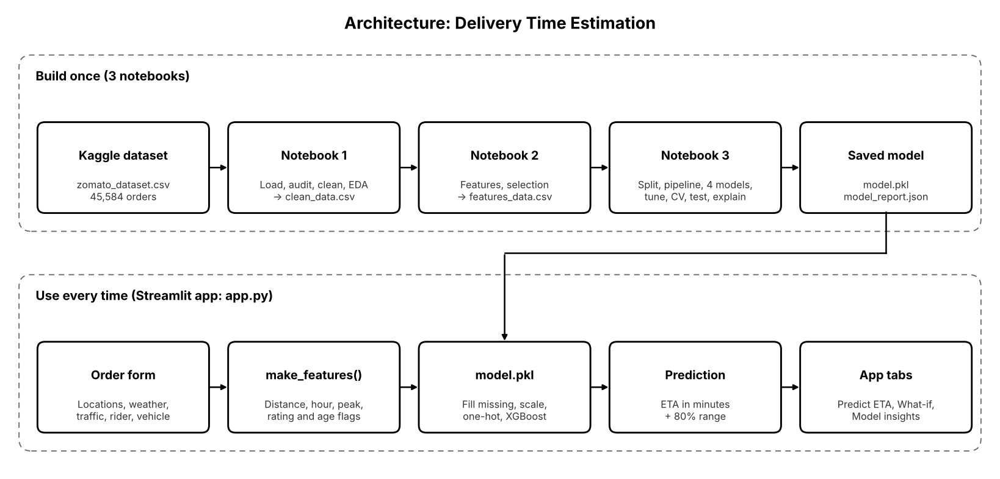
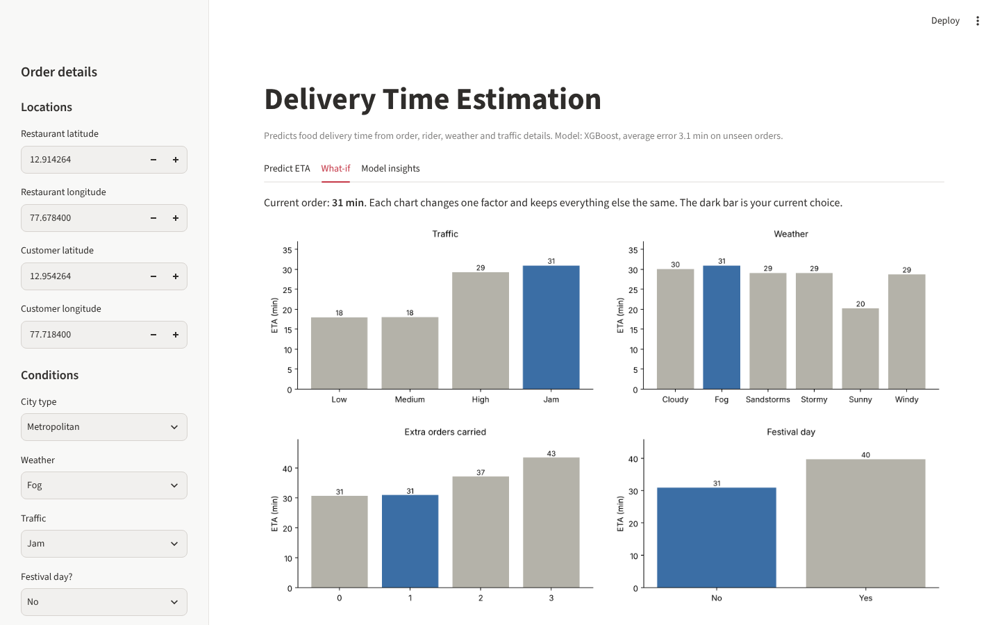
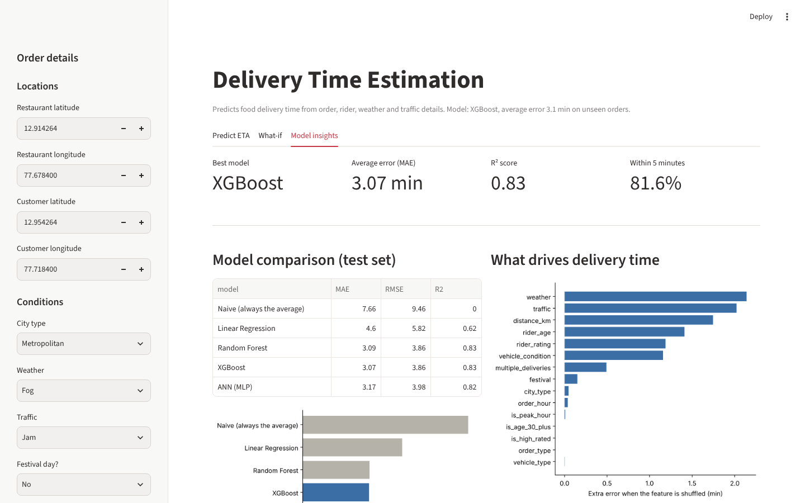

# Delivery Time Estimation

Predicting how many minutes a food delivery will take, using details about the order, the rider, the vehicle, the weather, the traffic and the location.

Built for a hackathon problem statement: **Machine Learning Regression Model for Predictive Analytics, Option C (Delivery Time Estimation)**.

**Live app:** https://deliverytimeestimation.streamlit.app/



<br>

## Results at a glance

| | |
|---|---|
| Best model | XGBoost (tuned) |
| Average error (MAE) on unseen orders | **3.07 minutes** |
| R² on unseen orders | **0.83** |
| Predictions within 5 minutes | **81.6%** |
| Error compared to always guessing the average | **60% lower** (7.66 → 3.07 min) |
| Prediction range | About -4.7 to +5.0 min around the ETA, holds for 80% of orders |

<br>

## The problem

Every food delivery app shows an estimated delivery time. If the estimate is too short, the order arrives "late" and the customer is unhappy. If it is too long, the customer may not order at all. The company also uses expected delivery time to plan which rider gets which order.

We predict the delivery time in minutes at the moment an order is assigned to a rider. Because the target is a continuous number, this is a regression problem.

<br>

## The data

| Item | Detail |
|---|---|
| Source | Kaggle, [Food Delivery Dataset](https://www.kaggle.com/datasets/gauravmalik26/food-delivery-dataset) by Gaurav Malik (first released for a HackerEarth competition) |
| File used | `data/raw/zomato_dataset.csv`, a lightly pre-cleaned copy (all 45,584 order IDs match the Kaggle original) |
| Size | 45,584 orders, 20 columns, 22 Indian cities, 11 Feb to 6 Apr 2022 |
| After cleaning | 41,863 orders (`data/processed/clean_data.csv`) |

Option C asks to estimate delivery time "based on route, traffic, courier characteristics, and package type". The dataset has all four:

| Option C asks for | Columns |
|---|---|
| Route | Restaurant and customer latitude / longitude, city type |
| Traffic | Road traffic density, weather, festival |
| Courier characteristics | Rider age and rating, vehicle type and condition, extra orders carried |
| Package type | Type of order (Snack, Meal, Drinks, Buffet) |

<br>

## How it works



The project has two parts. Three notebooks **build** the model once. The Streamlit app **uses** the saved model for every prediction.

| Step | File | What it does |
|---|---|---|
| 1 | `01_EDA_Delivery_Time.ipynb` | Loads the data, checks the schema, audits quality, cleans it (bad coordinates, Excel-format times, invalid ratings) and explores what affects delivery time |
| 2 | `02_Feature_Engineering.ipynb` | Builds new features (distance, order hour, peak-hour flag, rating and age flags), tests and drops useless ideas, saves the final feature table |
| 3 | `03_Models_and_Evaluation.ipynb` | Splits 80/20, builds the preprocessing pipeline, trains 4 models, tunes them, cross-validates, tests once on hidden data, explains the model, saves it |
| App | `app.py` | Takes an order from a form, builds the same features, loads the saved model and shows the ETA, a what-if analysis and model insights |

More detail in [docs/architecture.md](docs/architecture.md).

<br>

## Model comparison

All models were scored with 5-fold cross validation on the training set, then tested once on 8,373 hidden orders.

| Model | Test MAE (min) | Test RMSE (min) | Test R² |
|---|---|---|---|
| Naive (always predict the average) | 7.66 | 9.46 | 0.00 |
| Linear Regression (baseline) | 4.60 | 5.82 | 0.62 |
| ANN (MLPRegressor) | 3.17 | 3.98 | 0.82 |
| Random Forest (tuned) | 3.09 | 3.86 | 0.83 |
| **XGBoost (tuned)** | **3.07** | **3.86** | **0.83** |

<br>

## Key findings

- **Festival days** take 45.5 min on average against 26.0 min on normal days.
- **Each extra order** a rider carries adds time: 22.9 min with none, 47.9 min with three.
- **A traffic jam** adds about 10 minutes compared to low traffic.
- **Rider rating and age** act as sharp steps: delivery time drops at a rating of 4.5 and jumps at age 30.
- **Order type** (snack, meal, drinks, buffet) has no effect, which the model's feature importance confirms.
- **Our new features** cut XGBoost's error from 3.95 to 3.15 minutes in cross validation, a bigger gain than tuning.
- **The top drivers** in the final model are weather, traffic, distance, rider age, rider rating and vehicle condition.

<br>

## The app

| Tab | What it shows |
|---|---|
| Predict ETA | Predicted time, likely range, distance, order summary, map |
| What-if | ETA for every traffic level, weather type, number of extra orders, and festival vs normal day |
| Model insights | Scores, model comparison, feature importance, predicted vs actual, error by traffic level |





<br>

## How to run

**1. Install the libraries** (Python 3.10 or newer):

```
pip install -r requirements.txt
pip install jupyter
```

(`jupyter` is only needed to open the notebooks on your own computer, so it is not in `requirements.txt`. That keeps the cloud app light.)

**2. Run the notebooks in order** (Jupyter, VS Code or Google Colab), top to bottom. Each one saves the file the next one needs:

```
01_EDA_Delivery_Time.ipynb      -> data/processed/clean_data.csv
02_Feature_Engineering.ipynb    -> data/processed/features_data.csv
03_Models_and_Evaluation.ipynb  -> models/model.pkl, models/model_report.json
```

All outputs are already saved in the repository, so you can also go straight to step 3. If `model.pkl` fails to load on your computer (different library versions), run notebook 3 once to rebuild it.

**3. Start the app:**

```
streamlit run app.py
```

It opens in the browser at http://localhost:8501. The map needs internet; everything else works offline.

<br>

## Deploy on Streamlit Community Cloud (free)

1. Push this folder to a **public** GitHub repository (with `app.py` at the top level).
2. Go to https://share.streamlit.io and sign in with GitHub.
3. Click **Create app**, choose this repository, branch `main`, and main file path `app.py`.
4. Optionally pick a custom subdomain (for example `delivery-eta`), then click **Deploy**.
5. Paste the app link at the top of this README.

If the cloud server installs different library versions than the ones that created `models/model.pkl`, the app automatically trains the same model again from `data/processed/features_data.csv` (about 10 seconds, once). Free apps sleep after 12 hours without visitors; opening the link wakes them up in under a minute.

<br>

## Project structure

```
├── 01_EDA_Delivery_Time.ipynb       notebook 1: data checks, cleaning, EDA
├── 02_Feature_Engineering.ipynb     notebook 2: new features, feature selection
├── 03_Models_and_Evaluation.ipynb   notebook 3: models, tuning, testing, explanation
├── app.py                           Streamlit app
├── requirements.txt                 Python libraries
├── .streamlit/config.toml           app theme (light)
├── data/
│   ├── raw/zomato_dataset.csv       original data (never edited)
│   └── processed/                   clean_data.csv, features_data.csv
├── models/
│   ├── model.pkl                    best pipeline (preprocessing + XGBoost)
│   └── model_report.json            scores, prediction range, app settings
└── docs/
    ├── architecture.md              architecture, design decisions, challenges
    └── images/                      diagram and app screenshots
```

<br>

## Limitations

- The delivery locations in this dataset are partly synthetic (customer point = restaurant point + the same offset in latitude and longitude), so distance is a straight-line estimate, not a road distance.
- The data covers only about 8 weeks (Feb to Apr 2022), so seasonal effects are not included.
- Traffic is a label (Low to Jam), not a live traffic feed.

<br>

## Tech stack

Python, pandas, NumPy, Matplotlib, Seaborn, scikit-learn, XGBoost, joblib, Streamlit.
