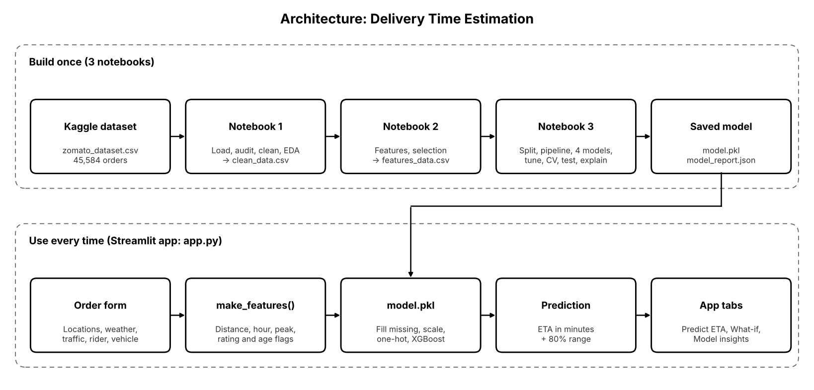

# Architecture and design



<br>

## 1. Overview

The system has two parts:

| Part | When it runs | What it does |
|---|---|---|
| Build | Once (or whenever the data changes) | Three notebooks clean the data, create features, train and test the models, and save the best one |
| Use | Every time someone asks for an ETA | The Streamlit app builds features for one order, loads the saved model and predicts |

The two parts share exactly two files: `models/model.pkl` and `models/model_report.json`.

<br>

## 2. Build: the three notebooks

### Notebook 1: `01_EDA_Delivery_Time.ipynb`

| Input | Output |
|---|---|
| `data/raw/zomato_dataset.csv` (45,584 rows) | `data/processed/clean_data.csv` (41,863 rows) |

1. **Load and schema check:** confirm all 20 expected columns exist; summarise types, missing values and duplicates.
2. **Data quality audit:** count every problem before fixing anything.
3. **Cleaning:**

| Problem | Rows | Fix |
|---|---|---|
| Zero coordinates | 3,640 | Dropped |
| Negative restaurant latitude / longitude | 431 / 162 | Removed the minus sign |
| Rider age 15 (all rated exactly 1.0) | 38 | Dropped (dummy rows) |
| Rider rating 6 (scale is 1 to 5) | 53 | Dropped |
| Order / pickup times in Excel decimal format | 4,068 / 4,127 | Converted to HH:MM |
| "Metropolitian" spelling | 34,087 | Renamed to "Metropolitan" |

Missing values are **not** filled here. They are filled later inside the model pipeline, using training data only, to avoid data leakage.

4. **EDA:** the target's distribution and outliers, and delivery time against every factor, plus correlations.

### Notebook 2: `02_Feature_Engineering.ipynb`

| Input | Output |
|---|---|
| `clean_data.csv` | `data/processed/features_data.csv` (15 features + target) |

**Prediction moment:** an order is assigned to a rider. Only information known at that moment may be used, so the pickup time is excluded (data leakage).

| New feature | How it is made | Evidence |
|---|---|---|
| `distance_km` | Haversine formula on the 4 coordinates | 21.5 min under 3 km, about 30 min above 12 km |
| `order_hour` | Hour from the order time | Fastest 8 to 10 am, slowest 19 to 21 |
| `is_peak_hour` | 1 if ordered 19:00 to 21:59 | 31.0 vs 24.1 min |
| `is_high_rated` | 1 if rating >= 4.5 | 24.3 vs 35.1 min |
| `is_age_30_plus` | 1 if age >= 30 | 29.6 vs 23.0 min |

Ideas tested and dropped: day of week, city code (no effect), food preparation wait (leakage and zero correlation).

### Notebook 3: `03_Models_and_Evaluation.ipynb`

| Input | Output |
|---|---|
| `features_data.csv` | `models/model.pkl`, `models/model_report.json` |

1. **Split:** 80% training, 20% hidden test set (`random_state=42`).
2. **Preprocessing pipeline:** numeric columns get median fill and scaling; categorical columns get most-frequent fill and one-hot encoding. This is joined to each model in one scikit-learn `Pipeline`.
3. **Four models:** Linear Regression (baseline), Random Forest, XGBoost, ANN (`MLPRegressor`, hidden layers 64 and 32, ReLU, Adam, early stopping).
4. **5-fold cross validation** on the training set (MAE, RMSE, R²).
5. **Feature check:** re-run without the new features to prove they help.
6. **Tuning:** `RandomizedSearchCV` (3-fold) for Random Forest, XGBoost and the ANN. A tuned version is kept only if it beats the default in 5-fold cross validation.
7. **Selection:** the lowest cross-validated MAE wins (XGBoost).
8. **Final test:** every model is scored once on the hidden test set, next to a naive baseline.
9. **Error analysis:** share of predictions within 3, 5 and 10 minutes; error by traffic level.
10. **Prediction range:** the 10th and 90th percentiles of cross-validated training errors give a band; on the test set, 80.2% of real times fall inside it.
11. **Explanation:** permutation importance on the test set, in minutes of extra error.
12. **Save:** the full pipeline to `model.pkl` and all scores and settings to `model_report.json`.

<br>

## 3. Use: the app (`app.py`)

```
Order form (sidebar)
   -> make_features()     same formulas as notebook 2 (distance, hour, peak, flags)
   -> model.pkl           fills missing values, scales, one-hot encodes, predicts with XGBoost
   -> ETA + range         range = ETA + the error band from notebook 3
   -> tabs                Predict ETA, What-if (re-predict with one change), Model insights
```

- The model is loaded once and cached (`st.cache_resource`), so clicks stay fast.
- If the coordinates give a distance far outside the 1.5 to 21 km the model learned from, the app shows a warning.
- If `model.pkl` cannot be loaded (for example on a cloud server with different library versions), the app trains the same pipeline again from `data/processed/features_data.csv`, using the same 80/20 split and the tuned XGBoost settings. This takes about 10 seconds, once, and a small note appears in the sidebar.

<br>

## 4. Design decisions

| Decision | Why |
|---|---|
| Preprocessing saved inside `model.pkl` | The app never scales or encodes by hand, so training and prediction cannot get out of sync |
| Same feature formulas in notebook and app | The model always receives the same kind of input it was trained on |
| Missing values filled inside the pipeline | Fill values come only from training data (no leakage) |
| Pickup time excluded | It is not known when the prediction is made |
| A naive baseline in the comparison | Shows how much the model actually adds (60% lower error) |
| Tuned model kept only if it is better | Tuning made the ANN slightly worse, so its default was kept |
| Range from cross-validated training errors | An honest range, checked on unseen data (80.2% coverage) |

<br>

## 5. Problem statement challenges and how we handled them

| Challenge | What we did |
|---|---|
| Missing or inconsistent data | Cleaning and validation rules in notebook 1; imputation inside the pipeline |
| Overfitting | 5-fold cross validation, a hidden test set, early stopping for the ANN; test scores match CV scores |
| Highly correlated features | Checked in notebook 2: no harmful pairs, so no PCA needed and every feature stays explainable |
| Slow model training | XGBoost on all CPU cores; RandomizedSearchCV instead of a full grid search |

<br>

## 6. Data dictionary

| Column | Meaning | Type |
|---|---|---|
| rider_age | Rider age in years | Number |
| rider_rating | Rider rating, 1 to 5 | Number |
| restaurant_lat / restaurant_lon | Restaurant location | Number |
| delivery_lat / delivery_lon | Customer location | Number |
| order_date | Date of the order | Text |
| time_ordered / time_picked | Order time and pickup time (HH:MM) | Text |
| weather | Sunny, Cloudy, Fog, Windy, Stormy, Sandstorms | Category |
| traffic | Low, Medium, High, Jam | Category |
| vehicle_condition | Condition score, 0 to 3 | Number |
| order_type | Snack, Meal, Drinks, Buffet | Category |
| vehicle_type | motorcycle, scooter, electric_scooter, bicycle | Category |
| multiple_deliveries | Extra orders the rider carries, 0 to 3 | Number |
| festival | Festival day (Yes / No) | Category |
| city_type | Metropolitan, Urban, Semi-Urban | Category |
| delivery_time_min | Delivery time in minutes (target) | Number |
